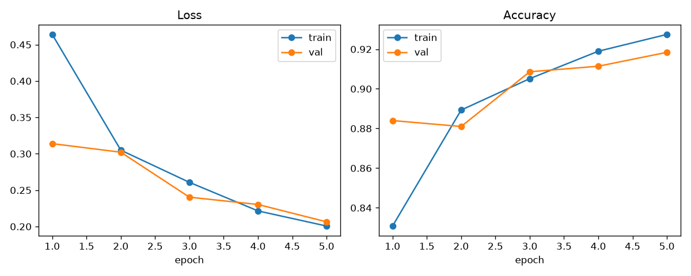
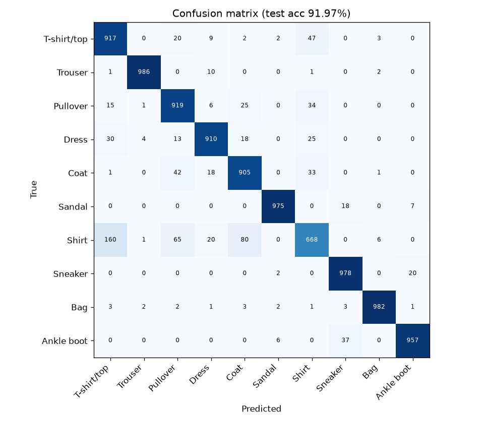

# Fashion-MNIST CNN Classifier (PyTorch)

A small, clean PyTorch project that trains a convolutional neural network to classify
clothing images from the [Fashion-MNIST](https://github.com/zalandoresearch/fashion-mnist)
dataset (10 classes, 28×28 grayscale, 60k train / 10k test images).

## Overview

- **Data**: loaded with `torchvision.datasets.FashionMNIST`, normalised, with random horizontal
  flips for training. 5,000 training images are held out as a validation set.
- **Model**: `FashionCNN` – two convolutional blocks (Conv → BatchNorm → ReLU ×2, MaxPool),
  followed by a dropout-regularised fully connected head. ~468K parameters.
- **Training**: Adam (lr 1e-3), cross-entropy loss, cosine learning-rate schedule;
  the checkpoint with the best validation accuracy is saved.
- **Evaluation**: overall and per-class test accuracy, plus a confusion matrix.

## Results

Trained for **5 epochs on CPU** (~25 s per epoch, seed 42):

| Metric | Value |
|---|---|
| Validation accuracy (best) | 91.84% |
| **Test accuracy** | **91.97%** (9,197 / 10,000) |

Per-class test accuracy: Trouser 98.6%, Bag 98.2%, Sneaker 97.8%, Sandal 97.5%,
Ankle boot 95.7%, Pullover 91.9%, T-shirt/top 91.7%, Dress 91.0%, Coat 90.5%, Shirt 66.8%.
"Shirt" is the hardest class – it is most often confused with T-shirt/top, Pullover and Coat.





Raw numbers: [`assets/history.json`](assets/history.json), [`assets/test_metrics.json`](assets/test_metrics.json).

## Setup

```bash
git clone https://github.com/Devam360/fashion-mnist-pytorch.git
cd fashion-mnist-pytorch
python -m venv .venv && source .venv/bin/activate
pip install -r requirements.txt
# CPU-only PyTorch (smaller download):
# pip install torch torchvision --index-url https://download.pytorch.org/whl/cpu
```

## Usage

```bash
# Train (downloads the dataset into ./data on first run)
python -m src.train --epochs 5 --batch-size 128 --lr 1e-3

# Evaluate the best checkpoint on the test set
python -m src.evaluate --checkpoint checkpoints/best.pt

# Run tests
python -m pytest -q
```

Training writes `checkpoints/best.pt`, `assets/training_curves.png` and `assets/history.json`;
evaluation writes `assets/confusion_matrix.png` and `assets/test_metrics.json`.

## Project structure

```
fashion-mnist-pytorch/
├── src/
│   ├── data.py        # dataset download, transforms, train/val/test loaders
│   ├── model.py       # FashionCNN architecture
│   ├── train.py       # training loop, checkpointing, training curves
│   └── evaluate.py    # test accuracy, per-class accuracy, confusion matrix
├── tests/
│   └── test_model.py  # output-shape and overfit-a-tiny-batch sanity checks
├── assets/            # plots and metrics from the run reported above
├── requirements.txt
├── LICENSE
└── README.md
```

## License

MIT – see [LICENSE](LICENSE).
